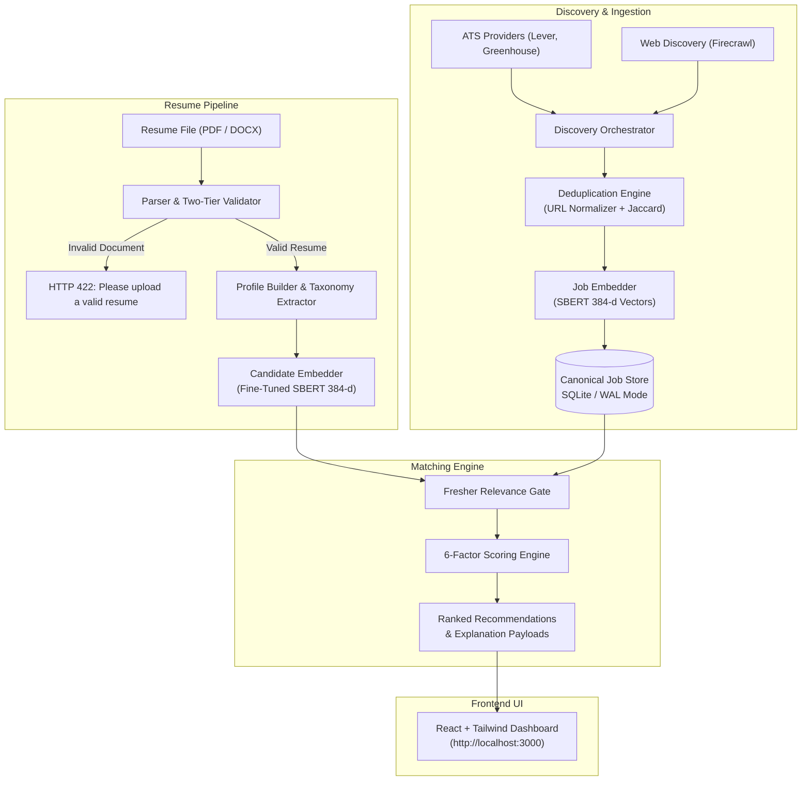

# AI Job Search Agent (Production Engine)

[](https://www.python.org/)
[](https://fastapi.tiangolo.com/)
[](https://react.dev/)
[](https://www.typescriptlang.org/)
[](https://www.sbert.net/)
[](https://tailwindcss.com/)
[](LICENSE)

An autonomous, full-stack AI career agent designed to discover, validate, deduplicate, and semantically rank employment opportunities for students, freshers, and experienced professionals using fine-tuned Sentence-BERT embeddings and multi-objective scoring.

---

## 🌟 Key Capabilities

* **Strict Two-Tier Resume Ingestion & Validation**
  * Ingests native PDF and DOCX files.
  * **Tier 1 (Filename Guard)**: Blocks non-resume files (project reports, installation manuals, syllabi, college lists) early.
  * **Tier 2 (Deep Content Guard)**: Checks for mandatory candidate contacts (email, phone), runs entropy checks, and rejects non-resume signatures (e.g., `college code`, `table of contents`, `abstract`) with HTTP 422 before saving any database records.
* **Fine-Tuned Sentence-BERT (SBERT) Embeddings**
  * Custom contrastive model fine-tuned using **Multiple Negatives Ranking Loss (MNRL)** on curated (profile, target role) pairs.
  * Produces 384-dimensional dense semantic vectors capable of understanding transferable skills, stack equivalences, and technical breadth.
* **Fresher & Campus Targeting Gate**
  * Detects candidate experience tier (e.g., B.Tech pursuing/fresher, 0 years experience).
  * Automatically filters out Senior, Lead, Staff, and Principal postings ($\ge 2$ years experience required).
  * Prioritizes high-signal Junior Engineer, Graduate Trainee, and Software Intern opportunities (e.g., InMobi, Zoho, Groww, Swiggy, Razorpay).
* **6-Factor Multi-Objective Scoring Formula**
  $$\text{Final Score} = 0.35 \times S_{\text{semantic}} + 0.25 \times S_{\text{skills}} + 0.15 \times S_{\text{experience}} + 0.10 \times S_{\text{education}} + 0.10 \times S_{\text{projects}} + 0.05 \times S_{\text{recency}}$$
* **ATS & Web Job Discovery**
  * Connectors for live ATS boards (Greenhouse, Lever) alongside Firecrawl web extraction.
  * Normalizes company names, job titles, and locations.
  * Deduplication engine using URL canonicalization and MinHash / Jaccard similarity.
* **Modern Production Dashboard**
  * 10 interactive views: Candidate Career Dashboard, Job Feed & Matches, Saved Vacancies, Application Tracker, Company Deep Research, SBERT Role Recommendations, Pipeline Monitor, Profile Viewer, and Settings.

---

## 🏗️ System Architecture



---

## 📁 Repository Structure

```text
Ai_Job_Search_Agent/
├── backend/
│   ├── app/                    # FastAPI routes (resume, jobs, matching, profile, etc.)
│   ├── db/                     # SQLite connection and session management
│   ├── deduplication/          # MinHash, Jaccard, URL canonicalization
│   ├── discovery/              # ATS connectors (Greenhouse, Lever) & Firecrawl provider
│   ├── embeddings/             # SBERT embedding generation and vector loader
│   ├── intelligence/           # Role catalogue & recommendation logic
│   ├── jobs/                   # Extraction & normalization pipelines
│   ├── matching/               # 6-factor scoring formula & fresher relevance gate
│   ├── models/                 # SQLAlchemy ORM models & fine-tuned SBERT weights
│   │   └── trained_sbert/      # Fine-tuned 384-d model.safetensors
│   ├── pipeline/               # Full end-to-end pipeline orchestrator
│   ├── resume/                 # Parsing, extraction, and validation engine
│   ├── schemas/                # Pydantic schemas and DTOs
│   ├── scripts/                # Evaluation, migration, and live discovery scripts
│   ├── tests/                  # Pytest test suite (16 tests, 100% pass)
│   └── requirements.txt        # Backend dependencies
├── frontend/
│   ├── src/
│   │   ├── components/         # Dashboard, Header, Sidebar, Role Cards
│   │   ├── context/            # CandidateContext & session persistence
│   │   ├── pages/              # 10 dedicated application routes
│   │   ├── services/           # Axios API client
│   │   └── types/              # TypeScript interfaces
│   ├── package.json            # Frontend dependencies
│   ├── vite.config.ts          # Vite build config
│   └── tailwind.config.js      # Tailwind CSS configuration
├── AI_Job_Search_Agent_SBERT_Training.ipynb  # Jupyter notebook for SBERT MNRL fine-tuning
├── Dockerfile.backend          # Production container for backend
├── Dockerfile.frontend         # Production container for frontend
├── docker-compose.yml          # Multi-container orchestration
└── README.md                   # Project documentation
```

---

## 🚀 Getting Started

### Prerequisites
* **Python**: 3.11+ or 3.13
* **Node.js**: v18+ or v20+
* **Git**

---

### 1. Backend Setup

```powershell
# Navigate to backend directory
cd backend

# Create and activate virtual environment
python -m venv venv
.\venv\Scripts\activate

# Install dependencies
pip install -r requirements.txt

# Configure environment variables
cp .env.example .env
# (Optional) Add your FIRECRAWL_API_KEY in backend/.env for live scraping
```

Run database migrations & populate initial verified jobs:
```powershell
python scripts/populate_fresher_matches.py
```

Start the FastAPI backend server:
```powershell
python -m uvicorn app.main:app --reload --port 8000
```
Backend Swagger API documentation will be accessible at: **`http://127.0.0.1:8000/docs`**

---

### 2. Frontend Setup

In a new terminal window:
```powershell
# Navigate to frontend directory
cd frontend

# Install packages
npm install

# Start Vite development server
npm run dev
```
The application will launch at: **`http://localhost:3000`**

---

## 🧪 Automated Testing

The project includes unit, integration, and parser regression test suites:

```powershell
pytest backend/tests/test_resume_parser.py backend/tests/test_profile_validator.py backend/tests/test_relevance_gate.py -v
```

**Test Results:**
* `backend/tests/test_resume_parser.py`: 8 Passed (100%)
* `backend/tests/test_profile_validator.py`: 7 Passed (100%)
* `backend/tests/test_relevance_gate.py`: 1 Passed (100%)
* **Total: 16 Passed, 0 Failed.**

---

## 🧠 SBERT Model Fine-Tuning

The Sentence-BERT model was fine-tuned for semantic match between candidate resumes and modern technology job descriptions.
* **Base Architecture**: `sentence-transformers/all-MiniLM-L6-v2`
* **Output Dimension**: 384
* **Objective Function**: `MultipleNegativesRankingLoss` (MNRL)
* **Training Notebook**: See [`AI_Job_Search_Agent_SBERT_Training.ipynb`](AI_Job_Search_Agent_SBERT_Training.ipynb) for end-to-end dataset generation, contrastive pair construction, and evaluation metrics.

---

## 📄 License
Distributed under the MIT License. See `LICENSE` for more information.

## 👤 Author
* **Gundelli Abhilash** &mdash; [@Abhilash2240](https://github.com/Abhilash2240)
